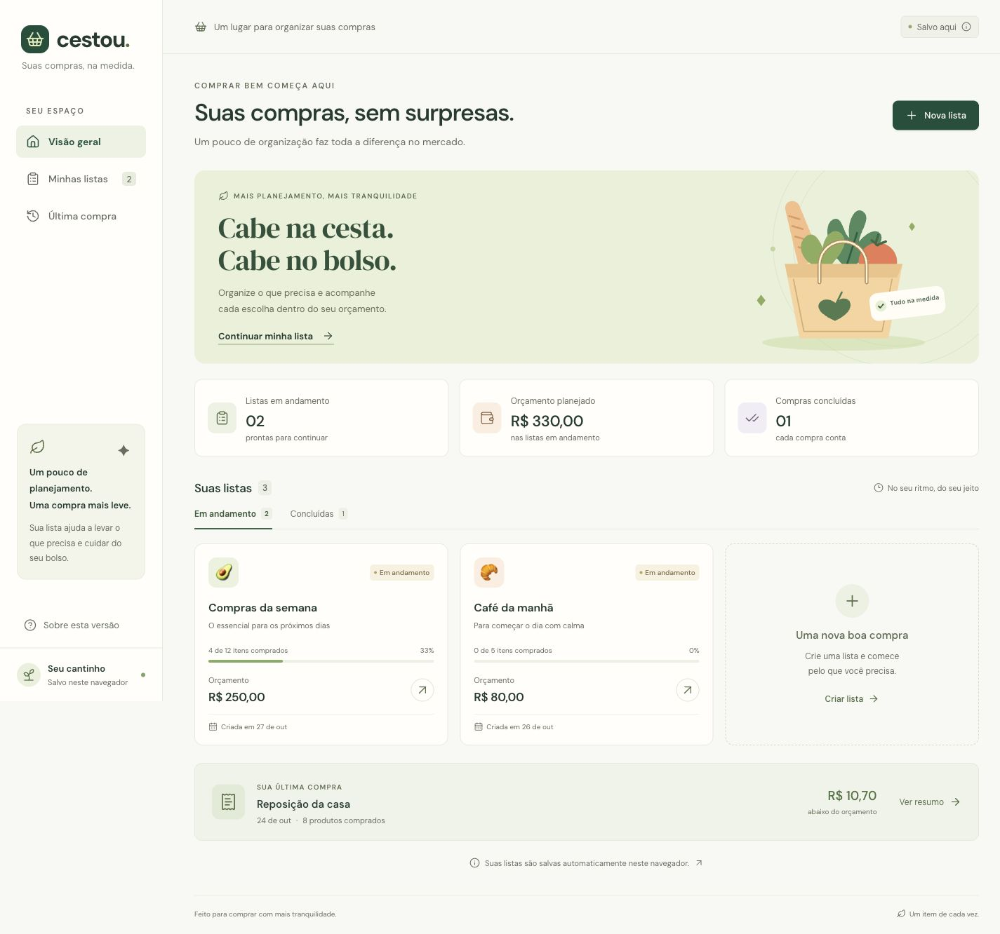

# Cestou

Uma aplicação web para planejar compras de mercado e acompanhar o orçamento enquanto os produtos entram no carrinho.

**Versão online:** [cestou-eta.vercel.app](https://cestou-eta.vercel.app)

**Código-fonte:** [github.com/LuanVasco/cestou](https://github.com/LuanVasco/cestou)



O MVP inclui três telas responsivas, salvamento automático com Zustand e localStorage e testes de interface com Playwright. Listas, produtos, preços, orçamentos e compras concluídas são recuperados ao atualizar ou reabrir a página no mesmo navegador.

## Executar

Use Node.js 22.12 ou superior dentro da linha 22.x. O arquivo `.nvmrc` aponta para a versão utilizada no desenvolvimento e a publicação usa a mesma linha principal.

```bash
nvm use
npm install
npm run dev
```

Acesse `http://127.0.0.1:5173`.

```bash
npm run typecheck # Verifica os tipos
npm test          # Executa os testes automatizados de persistência
npm run test:watch # Executa os testes em modo de desenvolvimento
npm run test:e2e   # Executa os testes de interface em desktop e celular
npm run build     # Verifica os tipos e gera dist/
npm run preview   # Serve o build de produção
npm run format    # Formata os arquivos com Prettier
```

## Telas

- **Visão geral** (`#/`): listas em andamento e concluídas, indicadores e acesso à última compra.
- **Lista de compras** (`#/lista/semana`): produtos por categoria, filtros, progresso e acompanhamento do orçamento.
- **Resumo da compra** (`#/resumo/ultima-compra`): produtos comprados, total pago, comparação com o orçamento e itens pendentes.

As rotas usam o fragmento da URL. O botão Voltar do navegador funciona, e a hospedagem estática dispensa regras especiais de redirecionamento.

## O que pode ser experimentado

- Criar e duplicar listas.
- Adicionar, editar e excluir produtos, com opção de desfazer a exclusão.
- Confirmar o preço por unidade antes de colocar um produto no carrinho.
- Desmarcar produtos e atualizar o orçamento em tempo real.
- Alterar o orçamento e consultar uma previsão parcial quando há itens sem estimativa.
- Finalizar uma compra e reutilizar a lista com os produtos desmarcados.

Essas ações são salvas automaticamente no navegador. Diálogos, filtros e avisos temporários continuam sendo estado local da interface.

## Como os dados são salvos

- O middleware `persist` do Zustand grava as listas na chave `cestou.shopping-lists`, com formato versionado (versão 1).
- O primeiro acesso cria e salva as listas de exemplo. Os acessos seguintes restauram os dados existentes, inclusive listas sem produtos e um conjunto vazio de listas.
- A leitura é síncrona: os dados salvos estão disponíveis antes da primeira renderização da interface.
- Somente os dados de compras são persistidos. Ações do store, avisos e diálogos não são serializados.
- O conteúdo recuperado é validado: tipos, quantidades, preços em centavos, datas, estados de compra e IDs únicos.
- Registros inválidos, incompatíveis ou inacessíveis são preservados sem sobrescrita. O app continua em memória e exibe um aviso de que as alterações daquela sessão não serão salvas.
- Se uma gravação falhar por falta de espaço ou bloqueio do navegador, as alterações continuam na sessão. Uma gravação posterior bem-sucedida salva o estado completo e remove o aviso.

O armazenamento é específico do navegador, dispositivo e endereço do site. Por exemplo, `localhost` e `127.0.0.1` usam espaços diferentes. Limpar os dados do site remove as listas. Janelas privativas podem descartar os dados quando forem fechadas. Não há conta, backend ou sincronização entre dispositivos.

## Regras demonstradas

- Os valores monetários são armazenados em centavos inteiros.
- O carrinho soma `quantidade × preço pago` dos produtos comprados.
- A previsão soma o carrinho às estimativas dos produtos pendentes.
- Itens pendentes sem preço são identificados para que a previsão não seja confundida com um total completo.
- A finalização considera somente os itens comprados.
- As quantidades do MVP são inteiras, por unidade ou pacote. Por exemplo, um pacote de 1 kg é cadastrado como uma unidade.

## Organização

```text
src/
  components/   Componentes compartilhados, diálogos, formulários e shell
  data/         Listas de exemplo usadas no primeiro acesso
  hooks/        Navegação por hash
  lib/          Formatação e cálculos monetários
  pages/        As três telas da aplicação
  store/        Estado Zustand, persistência, validação e testes
  styles/       Tokens, base e estilos compartilhados
  types.ts      Modelo de listas e produtos
```

**Stack:** React, TypeScript, Vite, Zustand, localStorage, CSS Modules e estilos compartilhados, ícones Lucide, Vitest, Playwright e Prettier. As fontes DM Sans e DM Serif Display são carregadas do Google Fonts, com fontes locais como alternativa.

A interface inclui navegação por teclado, foco visível, link para pular ao conteúdo, diálogos nativos, avisos anunciados a leitores de tela e tratamento de movimento reduzido.

## Verificação

Os testes de persistência recriam o store usando o mesmo armazenamento para simular recarregamentos. Cobrem listas pessoais, produtos, preços, orçamento, conclusão, exclusão e restauração, listas vazias, registros corrompidos, versões incompatíveis, acesso bloqueado e falha de gravação. O armazenamento dos testes é isolado e não acessa os dados do navegador.

### Testes de interface

Depois de instalar as dependências, instale o navegador do Playwright uma vez:

```bash
npx playwright install chromium
npm run test:e2e
```

A suíte em `e2e/shopping.spec.ts` executa cinco cenários em dois projetos: Chromium desktop (1440 × 1000) e Chromium com emulação do Pixel 7. São dez execuções no total.

| Cenário                | O que verifica                                                                                                                           |
| ---------------------- | ---------------------------------------------------------------------------------------------------------------------------------------- |
| Criação de lista       | Nome, orçamento, lista vazia, bloqueio de finalização sem produtos e recuperação após recarregar.                                        |
| Inclusão de produtos   | Quantidade, categoria, estimativa, produto sem preço e recuperação dos campos de edição.                                                 |
| Alteração do orçamento | Rejeição de zero, alteração válida e recuperação do novo valor.                                                                          |
| Registro da compra     | Preço efetivamente pago, multiplicação pela quantidade, marcação no carrinho e previsão com itens pendentes.                             |
| Fluxo completo         | Criação, produtos, orçamento, compra, finalização somente dos itens comprados e restauração do resumo após recarregar e abrir outra aba. |

Os cenários criam suas próprias listas e produtos pelos formulários, sem preencher o localStorage diretamente. Cada teste usa um contexto de navegador novo e isolado. O Playwright inicia e encerra seu próprio servidor em `http://127.0.0.1:4174`, sem reutilizar o servidor ou os dados pessoais da porta 5173. Não é necessário iniciar `npm run dev` antes da suíte.

```bash
npm run test:e2e -- --project=chromium-mobile # Executa apenas a emulação de celular
npm run test:e2e:ui                         # Abre o modo interativo
npm run test:e2e:report                     # Abre o relatório HTML da última execução
```

O relatório fica em `playwright-report/`. Em caso de falha, capturas e traces ficam em `test-results/` para diagnóstico. Esses arquivos são ignorados pelo Git. Os testes unitários do Vitest ficam limitados a `src/`, e os de interface ficam em `e2e/`.

## Próximos passos

Validação com pessoas usando o app durante compras reais e cobertura em outros motores de navegador.

## Publicação na Vercel

O projeto `cestou` está publicado em produção no espaço `luanvascos-projects`, em [https://cestou-eta.vercel.app](https://cestou-eta.vercel.app).

O arquivo `vercel.json` configura o preset Vite, a instalação com `npm ci`, o build com `npm run build` e a pasta de saída `dist/`. O Node.js fica fixado na linha 22.x pelo `package.json`. As rotas por hash permitem abrir as três telas sem regras extras de redirecionamento.

A `.vercelignore` exclui dependências locais, builds, capturas de documentação, relatórios de teste e arquivos de ambiente do envio. O vínculo local com a conta e o projeto fica em `.vercel/`, ignorado pelo Git.

Para uma nova publicação, autentique a conta desejada na CLI da Vercel, vincule o diretório ao projeto Cestou e execute:

```bash
vercel --prod
```

Para executar a mesma suíte de interface contra a versão online, com dados isolados de teste:

```bash
PLAYWRIGHT_BASE_URL=https://cestou-eta.vercel.app npm run test:e2e
```

Quando `PLAYWRIGHT_BASE_URL` é informado, o Playwright usa esse endereço e não inicia o servidor local.

Não são necessárias variáveis de ambiente. Cada visitante mantém suas próprias listas no localStorage do navegador; as listas do endereço local não são transferidas para o domínio online.

## Referência inicial

O padrão de inclusão e marcação de produtos foi inspirado na [lista de compras do Swiggy no Mobbin](https://mobbin.com/screens/de0f97bc-c665-431e-9cfc-7c47502f8bc8). A identidade visual e o acompanhamento do orçamento foram desenvolvidos para este projeto.
